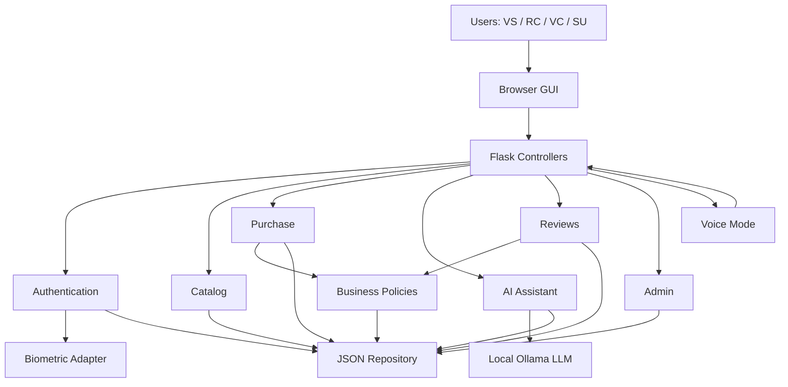

# Smart Bookstore System (SBS)

An AI-powered bookstore application developed for **CSC 322 — Software Engineering** at the City College of New York.

The Smart Bookstore System combines catalog management, simulated book purchasing, biometric authentication, AI-powered assistance, personalized recommendations, and automated customer membership management.

The application is designed to operate locally using **Python Flask, JSON storage, and Ollama**, without requiring a cloud database, real payment processing, or paid AI APIs.

## 1. Project Objectives

- Develop an interactive bookstore web interface.
- Support visitors, registered customers, VIP customers, and administrators.
- Implement face and voice biometric authentication.
- Allow customers to search, browse, and purchase books.
- Integrate a local AI assistant using Retrieval-Augmented Generation (RAG).
- Provide personalized book recommendations.
- Automate VIP promotions and discounts.
- Support customer reviews and content moderation.
- Maintain inventory, account records, and administrative audit history.

## 2. Technology Stack

| Component | Technology |
|---|---|
| Frontend | HTML, CSS, JavaScript |
| Backend | Python, Flask |
| Local Storage | JSON files |
| AI Assistant | Ollama, local LLM |
| AI Retrieval | Local catalog, policies, account records |
| Authentication | Replaceable face/voice biometric adapters |
| Architecture | Controller-Service-Repository |
| Testing | Pytest |
| Version Control | Git and GitHub |

## 3. System Architecture



### Architectural Components

**Frontend:** Provides catalog browsing, login, checkout, chatbot, reviews, and staff interfaces.

**Controllers:** Receive requests, check authorization, validate input, and invoke application services.

**Services:** Implement authentication, searching, purchasing, recommendations, moderation, and business rules.

**Repository:** Stores application data in local JSON snapshots with locking and atomic file replacement.

**AI Assistant:** Uses Ollama to generate responses grounded in authorized local bookstore records.

**Biometric Adapters:** Provide replaceable interfaces for face and voice recognition models.

## 4. User Roles

| Role | Permissions |
|---|---|
| Visitor (VS) | Browse, search, general AI assistance |
| Registered Customer (RC) | Purchase, reviews, balance, personalized recommendations |
| VIP Customer (VC) | All RC privileges and 10% discount |
| Super-User (SU) | Inventory management, moderation, account reinstatement |

VIP customers are automatically promoted after more than three completed purchases or more than $200 in lifetime spending.

## 5. Core Features

### Biometric Authentication
- Face or voice login for enrolled accounts.
- Role-specific sessions.
- Low-confidence matches are rejected.
- Suspended customers receive browse-only access.

### Book Catalog
- Search by title, author, category, publication date, or cover image.
- Display book details, ratings, prices, and availability.
- Use locally maintained catalog records.

### Purchasing System
- Simulated account balance.
- Inventory and order-history updates.
- A $1 fine when a purchase exceeds the available balance.
- Automatic suspension when the balance becomes negative.

### VIP Membership
- Automatic promotion based on purchase count or spending.
- A 10% discount on subsequent VIP purchases.

### AI Chat Assistant
- Local Ollama language model.
- Retrieval-Augmented Generation using bookstore records.
- Personalized responses for authenticated customers.
- Source disclosure for store-specific versus general answers.
- Authorization checks to protect customer information.

### Book Recommendations
- Top-three recommendations.
- Popularity-based suggestions for visitors.
- Personalized genre and author matching for customers.

### Ratings and Moderation
- One-to-five-star ratings.
- Higher weight for verified purchases.
- Taboo-word detection and censoring.
- Automatic comment blocking above three taboo words.
- Warning, suspension, and VIP demotion policies.

### Administrative Dashboard
- Add and edit books.
- Manage prohibited words.
- Reinstate suspended accounts.
- Maintain staff audit records.

### Voice Accessibility (Proposed)
- Voice-controlled searching.
- Spoken results.
- Explicit voice confirmation for purchases.
- Visual GUI fallback.

This feature remains subject to team approval.

## 6. Data Design

The application models the following entities:

- Account
- Session
- Biometric
- Book
- Order
- OrderLine
- Review
- Audit
- TabooWord
- PolicyDocument

Monetary amounts are stored as integer cents. Purchase history preserves historical prices.

Repository updates use a locked transaction and atomic JSON snapshot replacement to prevent partial updates.

## 7. Security and Reliability

- Server-side role-based authorization.
- Private records accessible only to authorized users.
- Temporary biometric samples discarded after matching.
- Failed biometric authentication denies access.
- Purchase transactions preserve data consistency.
- Administrative changes are audited.
- Local LLM failures return explicit errors.
- No real customer data or secrets are required for development.

## 8. Local Development

Prerequisites:

- Python 3
- Git
- Ollama for AI functionality
- A supported local biometric model for biometric login

Planned development commands:

```bash
git clone <repository-url>
cd smart-bookstore-system

python3 -m venv .venv
source .venv/bin/activate

pip install -r requirements.txt
python run.py
```

The commands above describe the intended setup after the implementation files are created. On Windows without WSL, virtual environment activation differs.

## 9. Testing

Testing will cover:

- Authentication and permissions.
- Catalog search and invalid filters.
- Purchase calculations and overspending.
- VIP promotion and discounts.
- Weighted ratings and moderation.
- JSON transaction consistency.
- AI assistant authorization.
- Administrative access controls.

Run the planned automated tests with:

```bash
pytest
```

## 10. Documentation

- `docs/SRS/` — Software Requirements Specification.
- `docs/design/` — Phase II Design Report.
- `docs/architecture/` — Architecture and design diagrams.

These documents define the expected behavior and proposed system design.

## 11. Project Team

**CSC 322 — Software Engineering**

**City College of New York**

**Team Y**

- Sufyaan Mohammed
- Muhaymen Dali
- Syed Karim
- Sazedur Khan
- Waliur Rahman Sun

## 12. Project Status

Design and implementation planning stage.

The SRS and Phase II Design Report define the system requirements and proposed architecture. Full backend implementation, integration, and testing remain to be completed.
