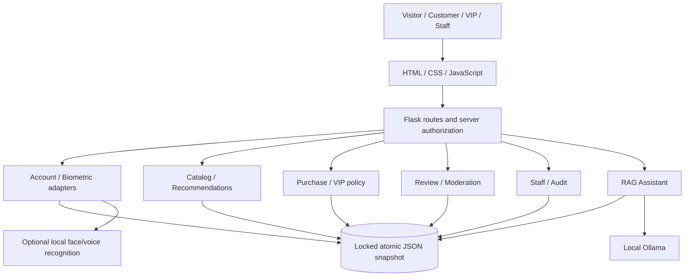

# Smart Bookstore System (SBS)

CSC 322 Software Engineering · City College of New York · Team Y

A locally hosted bookstore with Flask, JSON storage, simulated purchases, VIP discounts, review moderation, role-based admin tools, recommendations, and an optional Ollama RAG assistant. **Academic prototype; not a production ecommerce or authentication system.**

## Architecture



## Features

- Roles: **VS** visitors, **RC** customers, **VC** VIP customers, **SU** staff.
- Catalog: title/author/description search and genre filtering, detail pages, recommendations.
- Checkout: integer-cent accounting, stock decrement, historical order prices, $1 overspend fine, automatic suspension if balance becomes negative.
- VIP: promotion after **more than 3 orders OR more than $200 lifetime spending**, with a 10% discount on *later* purchases.
- Reviews: optional 1–5 stars, purchaser-weighted average (2 vs 1), taboo-word censorship, blocking when >3 matches, escalation, ordering flags.
- Admin: add/edit books, taboo list, reinstate accounts, audit actions.
- AI: local Ollama with authorized record retrieval, clear store-data/general-answer disclosure, explicit unavailability errors.
- Optional prototype face/voice matching; localhost-only demo account selector for testing.
- Optional browser-based voice catalog search; the full voice-purchase design is **not implemented**.

## Setup (Linux / macOS / WSL2)

```bash
python3 -m venv .venv
source .venv/bin/activate
pip install -r requirements.txt
cp .env.example .env
# Set environment variables (the sample .env file is NOT automatically loaded)
export SECRET_KEY="$(python3 -c 'import secrets; print(secrets.token_hex(32))')"
export DEMO_MODE=1
python run.py
```

Open **http://127.0.0.1:5000**. Choose **Login → Local development demo** and select Alex (RC), Taylor (VC), or Jordan (SU). Demo mode is for localhost classroom development only. Keep it **off** when sharing the app over a network.

Windows PowerShell: activate with `.venv\Scripts\Activate.ps1`, then set `$env:SECRET_KEY` and `$env:DEMO_MODE = '1'` before running `python run.py`.

Data starts with seeded mock accounts and six public-domain book titles. Actual purchase/payment fulfillment is **not performed**. Delete `data/store.json` to reset the demo.

## Ollama (optional)

Install Ollama, then run:

```bash
ollama pull llama3.2:3b
ollama serve
```

If Ollama is already running, don't start a second server. Customize `OLLAMA_URL` and `OLLAMA_MODEL` via environment variables. The assistant retrieves the current catalog, policies, and (for logged-in customers) only their own orders/balance. It does not use an embedding vector index; this is a simple keyword-based RAG prototype.

## Optional biometric recognition

Install `requirements-biometric.txt` and platform dependencies (plus `ffmpeg` for voice). Provide **consented demo enrollment** files in `data/biometrics/`, e.g. `rc1.jpg` for a single enrolled face, or `rc1.wav` for a voice reference. Submit a live photo or audio recording through the login page. Face matching uses optional `face_recognition`; voice matching uses optional `resemblyzer` embedding similarity. These are basic local research adapters, not identity-proofing systems: **no liveness or spoofing resistance**, and thresholds must be calibrated. Production should use a real enrollment workflow and anti-spoofing verification. Never commit enrolled media or real personal biometric data.

## Tests

```bash
pytest -q
```

## Project directories

- `app/__init__.py` — Flask routes and role checks
- `app/services.py` — checkout, VIP, recommendations, ratings, admin rules
- `app/repository.py` — file-locked atomic snapshot transaction
- `app/ai.py` — Ollama assistant and authorized retrieval
- `app/biometrics.py` — optional local biometric prototype
- `app/templates/`, `app/static/` — user interface
- `tests/` — automated tests
- `docs/` — original SRS and design documentation

## Design status / limitations

Implemented: main catalog (text/genre), simulated cart and purchase, VIP membership, reviews, staff operations, keyword retrieval AI, basic optional biometric adapters, and read-only voice search through browser speech recognition.

Not implemented: book-cover image similarity search, production face/voice enrollment and anti-spoofing, a true offline speech-to-text stack, fully offline voice-first purchasing, browser-verified purchase confirmation through voice, or a traditional database. The SRS's numeric moderation/rating choices are proposed design constants; review them with the team. This repository uses sample data and is not hardened for public deployment.

## Team Y

Sufyaan Mohammed · Muhaymen Dali · Syed Karim · Sazedur Khan · Waliur Rahman Sun
